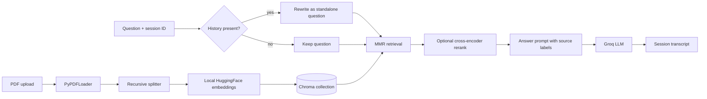

# Conversational RAG Q&A

[](https://github.com/AliYasser27/Conversational-RAG-QA-System/actions/workflows/ci.yml)


A Streamlit app for asking questions over your own PDFs. Documents are parsed and
embedded locally, retrieved with MMR, and answered by a Groq-hosted LLM that cites
the chunks it used. Each chat session keeps its own transcript, so follow-up
questions such as *"and what does it say about cost?"* are rewritten using that
session's history before retrieval.

## Why this design

- **History-aware retrieval.** The follow-up is reformulated into a standalone
  question before it reaches the vector store. Retrieval and generation are two
  separate steps, not one opaque call.
- **Grounded answers.** Retrieved chunks are labelled `[1] file.pdf, p.3` and the
  answer prompt requires citations, which makes responses easy to verify.
- **Swappable engines.** `ChatEngine` is a protocol; the Streamlit layer only
  talks to that protocol. The included FAQ demo uses the same interface as the
  RAG engine, so the Strategy pattern is demonstrable without an API key.
- **Secrets stay in memory.** The Groq key is entered at runtime (or read from
  `GROQ_API_KEY` for local development) and is never written to disk or config.
- **Configuration is validated.** `config.yaml` is loaded once into typed,
  immutable dataclasses; bad values fail early with a useful message.

## Architecture



## Quick start

```bash
git clone https://github.com/AliYasser27/Conversational-RAG-QA-System.git
cd Conversational-RAG-QA-System

python -m venv .venv
source .venv/bin/activate          # Windows: .venv\Scripts\activate

pip install -r requirements.txt
streamlit run app.py
```

Open <http://localhost:8501>, paste a [Groq API key](https://console.groq.com/keys),
upload one or more PDFs, and click **Process PDFs**. On first use the embedding
model is downloaded from HuggingFace and cached locally.

For local development you can set `GROQ_API_KEY` instead of pasting it each run:

```bash
cp .env.example .env   # then fill in the key and export it in your shell
```

## Configuration

All tunables live in `config.yaml` at the project root:

| Section | Key | Meaning | Default |
| --- | --- | --- | --- |
| `llm` | `model` | Groq model used for rewriting and answering | `llama-3.3-70b-versatile` |
| `llm` | `temperature` | Sampling temperature | `0.3` |
| `embeddings` | `model` | Local SentenceTransformers model | `all-MiniLM-L6-v2` |
| `chunking` | `chunk_size` / `chunk_overlap` | Splitter sizes in characters | `1000` / `200` |
| `retrieval` | `search_type` | `mmr` for diversity, `similarity` for pure ranking | `mmr` |
| `retrieval` | `k` / `fetch_k` / `lambda_mult` | Results returned, MMR pool, diversity weight | `4` / `20` / `0.5` |
| `reranking` | `enabled` / `model` / `top_k` | Optional cross-encoder second stage | `false` |
| `vector_store` | `collection_name` / `persist_directory` | Chroma collection and on-disk path | `pdf_collection` / `./chroma_db` |

Environment overrides: `RAG_CONFIG_PATH`, `RAG_LLM_MODEL`, `RAG_EMBEDDINGS_MODEL`,
`RAG_TEMPERATURE`, `RAG_RETRIEVAL_K`.

## Usage notes

- **Sessions:** create, switch, and delete chats in the sidebar. Switching saves
  the current transcript and reloads the selected one. Clearing a chat also
  clears its LLM message history.
- **Re-indexing:** processing a new set of PDFs replaces only the configured
  Chroma collection and resets old transcripts, since they referred to the
  previous index.
- **FAQ demo:** select it in the sidebar to see the engine swap in action. It
  needs no key and no documents.
- **File limits:** PDFs are capped at 25 MB each; text extraction failures are
  surfaced in the UI rather than crashing the app.

## Project structure

```text
app.py                  Streamlit UI, session orchestration, Chatbot facade
settings.py             Typed config loading + validation
config.yaml             Runtime tunables (no secrets)
engines/base.py         ChatEngine protocol
engines/simple_faq.py   Deterministic reference engine
engines/rag_engine.py   RAG adapter (chain -> text, per-session history)
rag/ingest.py           PDF loading, chunking, embeddings, Chroma indexing
rag/pipeline.py         Prompts, history-aware retrieval, optional reranking
tests/                  Dependency-light unit tests
.github/workflows/ci.yml Lint, byte-compile, and test on push / PR
requirements.txt        Runtime dependencies
pyproject.toml          Package metadata, dev extras, Ruff configuration
```

## Tests

```bash
python -m unittest discover -s tests -v
```

The tests cover config validation, both engines, source formatting, retriever
configuration, and reranking. They avoid heavyweight imports, so they run
without downloading models or contacting an LLM provider. CI also runs Ruff and
byte-compiles every module.

## Limitations and next steps

- Chat history is in memory; restarting the process clears it. A Redis or SQL
  backend would make it durable across workers.
- Chroma is embedded and local. A hosted vector database would be needed for a
  multi-user deployment.
- Reranking is opt-in because the cross-encoder adds a model download and latency.
- There is no authentication or automated answer-quality evaluation (RAGAS) yet.

## License

MIT — see [LICENSE](LICENSE).
